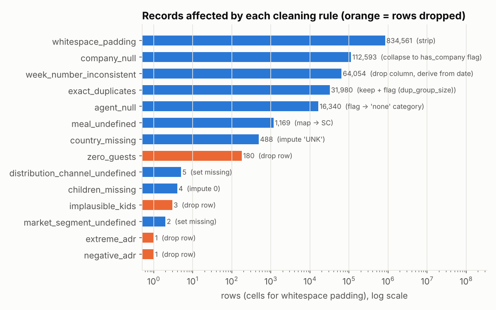
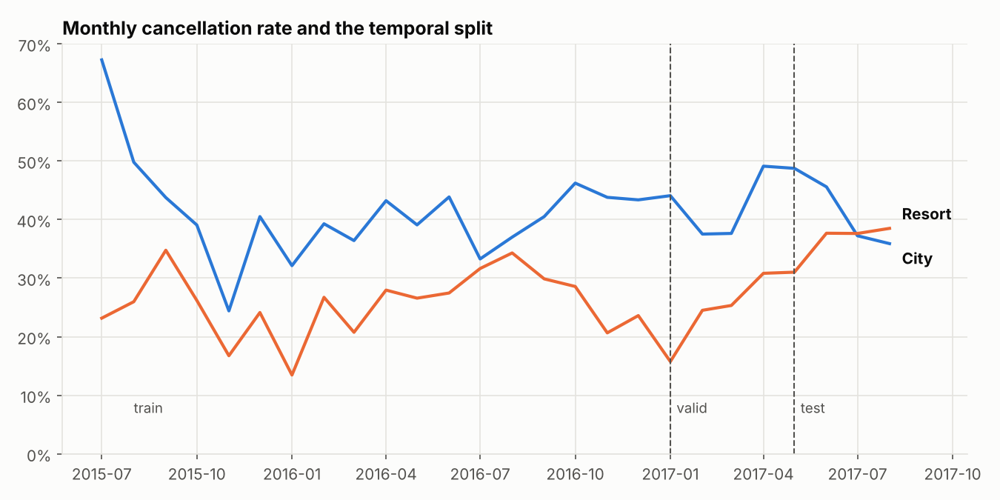
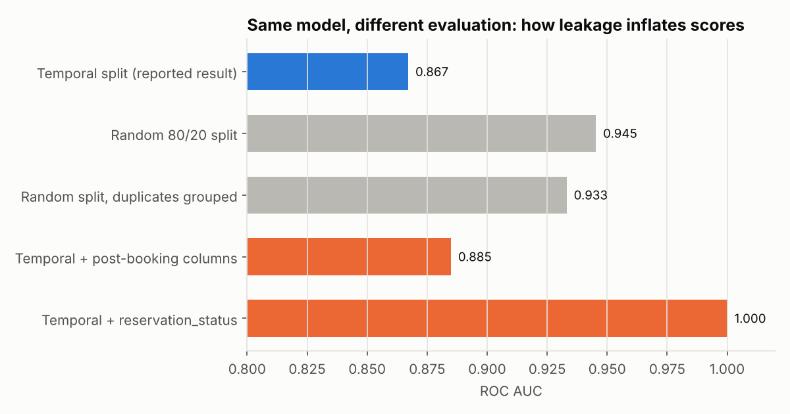
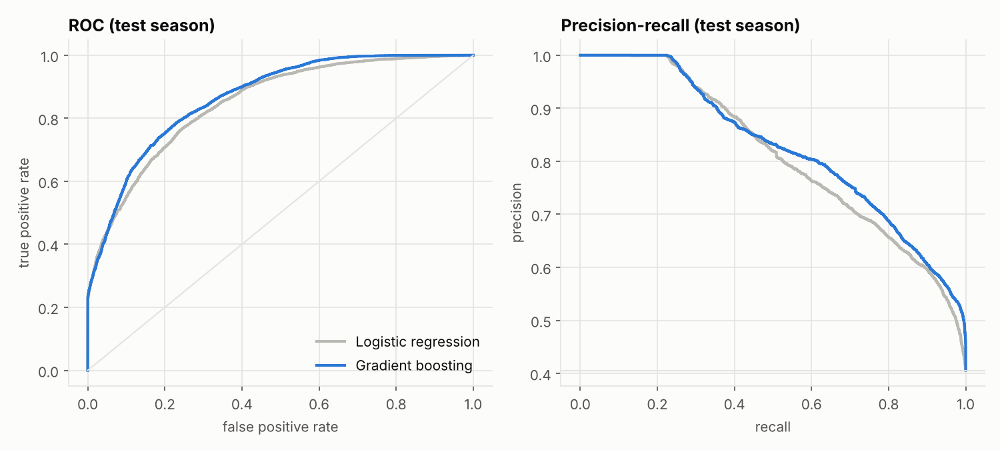
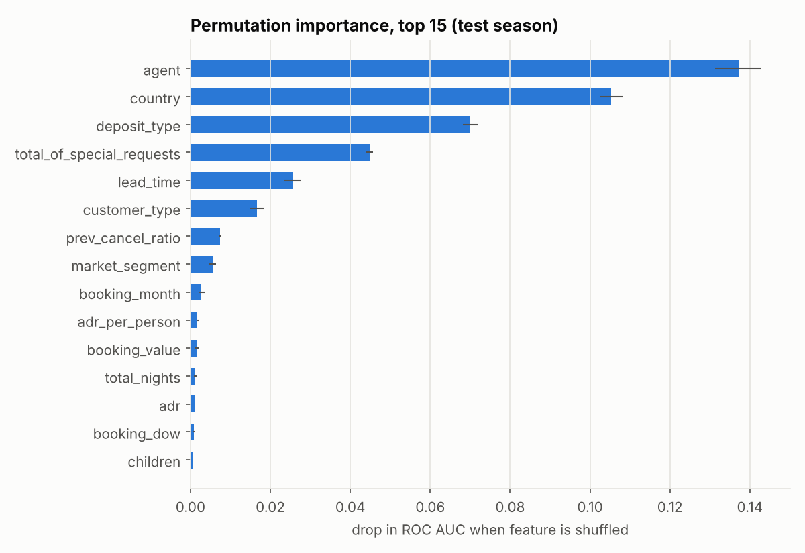
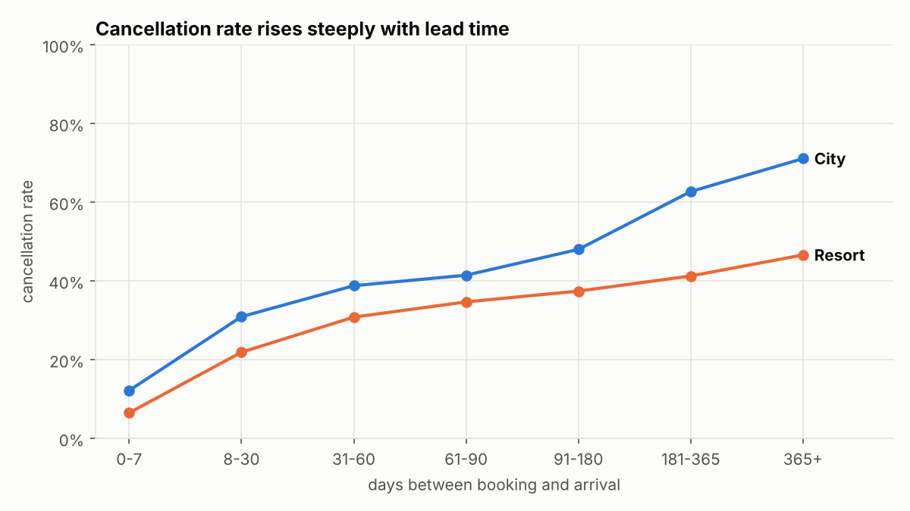
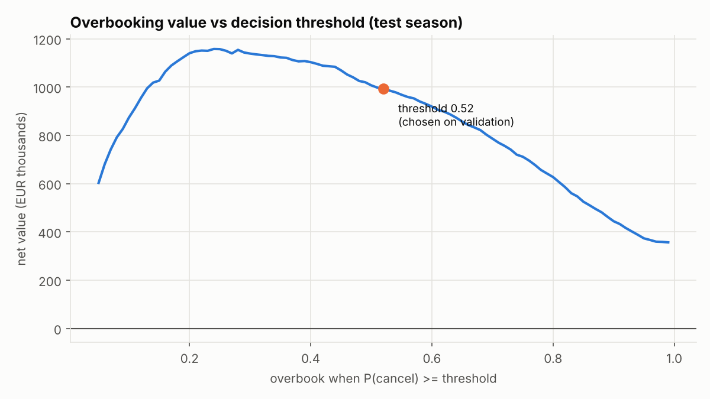
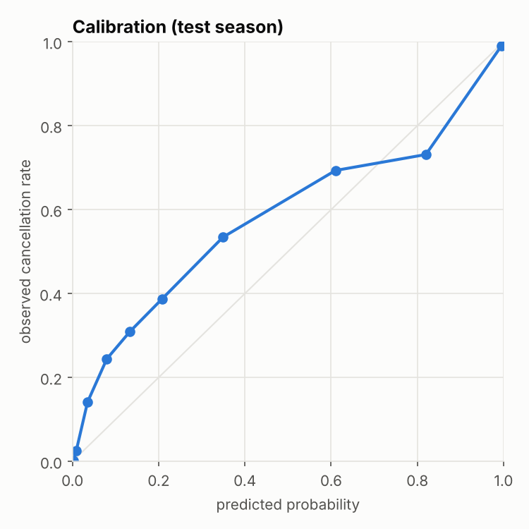

# Hotel Booking Cancellation Prediction

**Predicting which bookings will cancel, from messy raw hotel-system extracts to a cost-aware overbooking decision.**

  

37% of bookings in this data are cancelled. A hotel that knows *which* ones can resell those rooms, but every wrong guess means a guest arrives to a full hotel and has to be relocated at the hotel's expense. This project builds that decision end to end: it cleans two raw property-management-system (PMS) extracts, enforces a data contract, trains and compares models under an evaluation design that mirrors deployment, and picks the decision threshold by money rather than by accuracy.

The most useful result is a cautionary one. **The same model scores 0.945 ROC AUC under a random split but 0.867 on the genuinely unseen future season.** Most public notebooks on this dataset report the first number. This repo explains where the gap comes from and reports the second.

---

## Key results (test season: May to Aug 2017, 22,177 bookings never seen in training or tuning)

| Model | ROC AUC | PR AUC | Brier | ECE |
|---|---|---|---|---|
| Majority-class baseline | 0.500 | 0.406 | 0.243 | 0.043 |
| Logistic regression | 0.849 | 0.811 | **0.157** | **0.050** |
| **Gradient boosting (HistGB)** | **0.867** | **0.826** | 0.160 | 0.101 |

At the business threshold (0.52), gradient boosting flags 6,286 bookings with **81% precision and 57% recall**.

| Overbooking policy (test season) | Net value |
|---|---|
| Do nothing | EUR 0 |
| Rule of thumb: overbook every non-refundable booking | EUR 356k |
| Logistic regression @ validation-chosen threshold | EUR 990k |
| **Gradient boosting @ validation-chosen threshold** | **EUR 993k** |
| Gradient boosting @ best threshold in hindsight (0.24) | EUR 1,158k |
| Perfect foresight (upper bound) | EUR 2,494k |

*Assumptions (in `config.yaml`): resold rooms recover 50% of booking revenue; each walked guest costs EUR 250.*

---

## 1. The data and why it is messy

**Source:** Antonio, Almeida & Nunes (2019), *Hotel booking demand datasets*, Data in Brief 22. Real bookings from a resort hotel (`H1.csv`) and a city hotel (`H2.csv`) in Portugal, July 2015 to August 2017, 119,390 rows. The raw files in `data/raw/` are the original extracts as redistributed by [TidyTuesday](https://github.com/rfordatascience/tidytuesday/tree/master/data/2020/2020-02-11), *not* the pre-cleaned Kaggle version.

Problems found during profiling (full table auto-generated in [`reports/data_quality_report.md`](reports/data_quality_report.md)):

| Issue | Scale | Decision |
|---|---|---|
| Fixed-width padding (`"BB       "`, `"       NULL"`) | 834k cells | Strip everywhere |
| Literal `"NULL"` strings instead of missing values | 129k cells | Agent: NULL means *no agent*, kept as its own category. Company: 94% NULL, collapsed to a `has_company` flag |
| `"Undefined"` placeholders | 1,176 | Meal: mapped to `SC` (the data dictionary says they're equivalent). Market/channel: set missing |
| Week-number column disagrees with the calendar | 64k rows | Source uses a non-ISO convention. Dropped; all calendar features derived from the actual date |
| Exact duplicate rows | 31,980 | **Kept and flagged** (see below) |
| Zero-guest bookings, negative ADR, ADR of 5,400/night, 10 babies in a room | 185 rows | Dropped |
| `"NA"` appears as a missing marker in `children` | 4 rows | Imputed 0. *Not* replaced globally, because `NA` is also Namibia's country code |



### Duplicates: why they're kept

There is no booking ID, so 32k rows are byte-for-byte identical. They are mostly group blocks: 93% of all non-refundable bookings sit in duplicate groups, and duplicates cancel at 58% versus 26% for unique rows. Deleting them would quietly erase most group behaviour from the data.

Instead the pipeline keeps them, flags each row's `dup_group_size`, and relies on the temporal split: identical rows share an arrival date, so a group never straddles train and test. The flag is used for evaluation only (the test set is also scored de-duplicated) and never as a feature, because the duplicate key includes the label.

## 2. Leakage: five columns that would make the model look perfect

| Column | Why it leaks |
|---|---|
| `reservation_status` | It *is* the label (`Canceled` / `No-Show` / `Check-Out`) |
| `reservation_status_date` | The date the cancellation happened |
| `assigned_room_type` | Assigned at check-in. Rooms differ from the reservation for 12.5% of bookings, and those bookings cancel at only 5% |
| `required_car_parking_spaces` | Recorded on arrival; 0% cancellation when > 0 |
| `booking_changes` | Accumulates until check-in or cancellation |

These are listed in `config.yaml` and a unit test fails if any of them reaches the feature set.

## 3. Evaluation design: the split matters more than the model

Cancellation behaviour drifts. The resort's rate jumps from about 25% to 37% in summer 2017:



So the data is split by **arrival date**, training on the past and testing on the future:

| Split | Arrivals | Rows | Cancel rate |
|---|---|---|---|
| Train | Jul 2015 to Dec 2016 | 78,586 | 36.2% |
| Validation (model + threshold selection) | Jan to Apr 2017 | 18,442 | 36.5% |
| Test (touched once) | May to Aug 2017 | 22,177 | 40.6% |

Holding the model fixed and changing only the evaluation:



- **Random split (0.945)**: optimistic for two reasons. Duplicate rows land on both sides, and the model gets to see the future.
- **Random split with duplicate groups kept together (0.933)**: removes the duplicate effect. Most of the remaining gap is temporal drift.
- **Post-booking columns (0.885)** and **`reservation_status` (1.000)**: what leakage looks like when it is subtle and when it isn't.

## 4. Modelling

Everything learned from data (rare-category grouping, imputation, scaling, encoding) lives inside scikit-learn `Pipeline`s and is fit on training rows only. Feature engineering is row-wise and uses only information known when the booking is made: total nights and guests, family flag, ADR per person, booking value, prior-cancellation ratio, booking and arrival weekday, cyclical month encoding.

- **Logistic regression**: one-hot encoding with infrequent-category grouping and scaled numerics. Tuned over C.
- **HistGradientBoosting**: native categorical splits (country, agent, room type), early stopping. 16-config grid selected on validation **log loss**, because probabilities feed a cost calculation and need to be good probabilities, not just a good ranking.

The final models are refit on train + validation with the selected settings and scored once on test.



### What drives cancellation



Permutation importance (drop in test AUC when a feature is shuffled) ranks **travel agent**, **country**, **deposit type**, **special requests** and **lead time** highest. Lead time has the most intuitive shape: bookings made a year ahead cancel about 70% of the time at the city hotel.



One anomaly is worth flagging rather than exploiting: **non-refundable bookings cancel 99.4% of the time**. That is the opposite of what the name implies and is widely suspected to be an artefact of how group blocks were recorded. The model uses it, but a production system should confirm the meaning with the hotel before trusting it.

## 5. From probability to decision

Policy: if P(cancel) is at or above a threshold, resell the room. A correct flag recovers half the booking's revenue; a wrong flag costs EUR 250 to relocate the guest. The threshold that maximises value on the **validation** season (0.52) is frozen and then applied to test.



### The honest finding: drift costs about EUR 165k

On the test season, the hindsight-optimal threshold is 0.24, not 0.52, and would have earned EUR 1.16M instead of EUR 0.99M. The calibration plot shows why: cancellations rose in summer 2017, so the model systematically **under-predicts** (ECE 0.10).



Two consequences:

1. Gradient boosting wins on ranking (AUC), but logistic regression is better calibrated under drift (Brier 0.157 vs 0.160, ECE 0.05 vs 0.10). Their business value ends up nearly identical. In production, the simpler, more stable model is a reasonable choice.
2. The bigger lever is **not a fancier model but monitoring**. Recalibrating on a rolling recent window and re-tuning the threshold monthly would capture most of that EUR 165k.

## 6. Limitations and next steps

- **Recalibration and drift monitoring**: isotonic or Platt recalibration on the latest weeks, plus PSI alerts on lead time, agent and country mix.
- **Split by booking date**: arrival-date splitting is standard here, but a true deployment simulation would score bookings as they are *made*. That requires handling right-censoring at the end of the extract (late-2017 arrivals are missing).
- **Agent cold start**: agent ID is the top feature and new agents fall into the "infrequent" bucket. Target encoding with time-aware smoothing would help.
- **Richer cost model**: walk cost and resell rate vary by season and room type; the threshold could be per segment.
- **Model zoo**: LightGBM or CatBoost, and SHAP for per-booking explanations, are drop-in upgrades when available.

## Project structure

```
hotel-cancellation-ml/
├── config.yaml                  # every tunable number: split dates, leakage list, search grid, costs
├── data/raw/                    # original H1.csv / H2.csv, untouched
├── src/hotel_ml/
│   ├── ingest.py                # read raw text, union hotels, snake_case
│   ├── clean.py                 # 14 logged cleaning rules -> CleaningLog
│   ├── validate.py              # data contract; pipeline refuses to train if it fails
│   ├── features.py              # leakage-safe, row-wise features
│   ├── models.py                # sklearn Pipelines (LogReg, HistGB)
│   ├── evaluate.py              # AUC, PR-AUC, log loss, Brier, ECE, P/R/F1
│   ├── business.py              # overbooking value and threshold selection
│   ├── plots.py                 # report figures
│   └── pipeline.py              # end-to-end orchestration (CLI)
├── tests/                       # 15 tests on synthetic "messy" fixtures
├── reports/
│   ├── metrics.json             # every number in this README
│   ├── data_quality_report.md   # generated
│   ├── model_search.csv, cleaning_log.csv, permutation_importance.csv
│   └── figures/
└── .github/workflows/ci.yml     # lint + tests + smoke run on every push
```

## Reproduce

```bash
git clone https://github.com/<your-username>/hotel-cancellation-ml.git
cd hotel-cancellation-ml
python -m venv .venv && source .venv/bin/activate   # Windows: .venv\Scripts\activate
pip install -e ".[dev]"

make test     # 15 unit tests
make run      # full pipeline, about 3 minutes on a laptop
```

All results are deterministic (`random_state: 42`). Every number in this README comes from `reports/metrics.json`.

## Tools

pandas, NumPy, scikit-learn (HistGradientBoosting, Pipelines, permutation importance), matplotlib, PyYAML, pytest, GitHub Actions.
